# HablaFluido — Inglés con IA

App en Flutter para aprender inglés con un tutor de IA: pronunciación, dictado, lectura, escritura, conversación y repaso con repetición espaciada (SM-2). Incluye un **proxy en Node** (`proxy/`) para no exponer la llave de la IA.

Proyecto hecho con **TDD** (primero la prueba en rojo, luego el código para ponerla en verde) siguiendo el manual de la materia.

## Cómo correr las pruebas

```
flutter test
```

Pruebas del proxy:

```
cd proxy
node --test
```

## La app funcionando en el celular

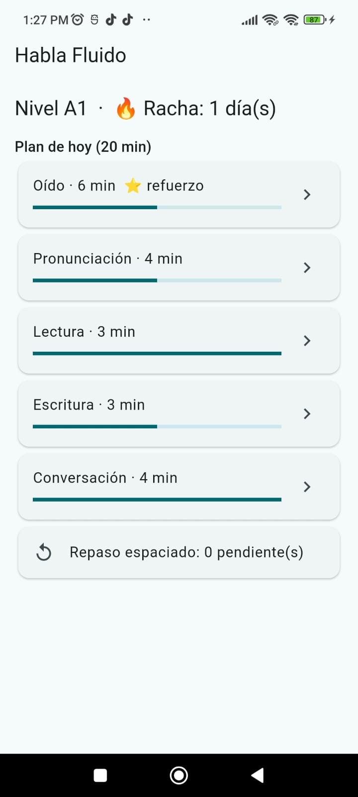

---

## Evidencias TDD (rojo → verde)

**Alumna:** Yaneli Sánchez Cárdenas · **Grupo:** GTID244

Cada ronda muestra primero la prueba en **rojo** (falla porque el código todavía no existe) y después en **verde** (pasa ya con el código hecho).

### Ronda 1

**Rojo — la prueba falla**

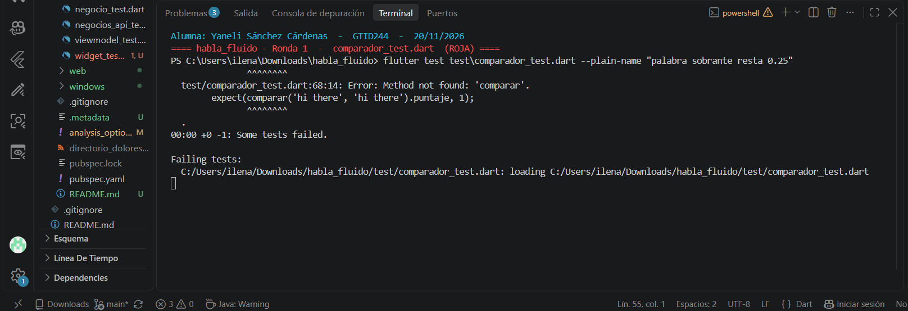

**Verde — la prueba pasa**

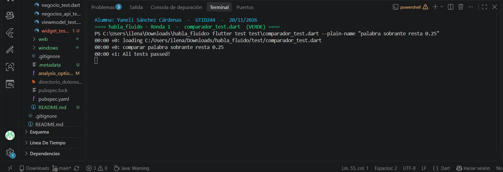

### Ronda 2

**Rojo — la prueba falla**


**Verde — la prueba pasa**

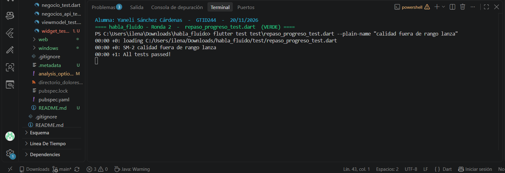

### Ronda 3

**Rojo — la prueba falla**

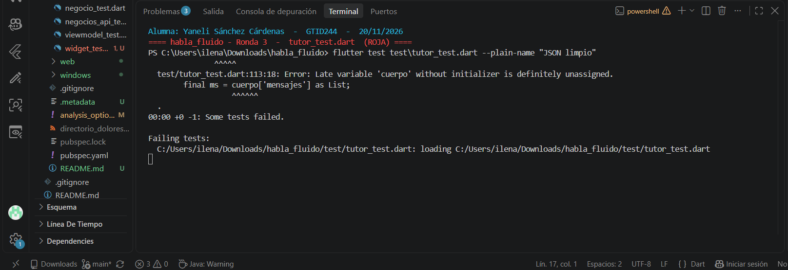

**Verde — la prueba pasa**

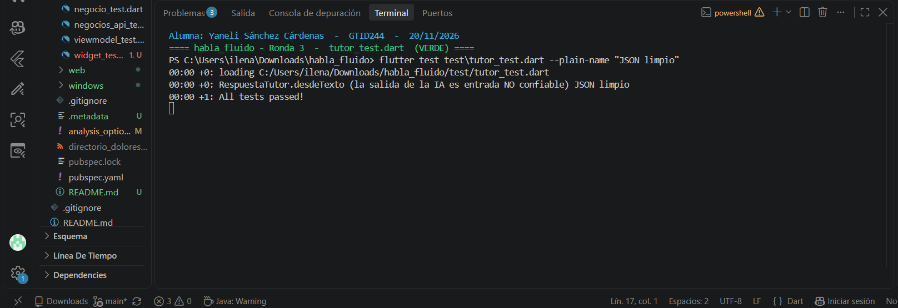

### Ronda 4

**Rojo — la prueba falla**

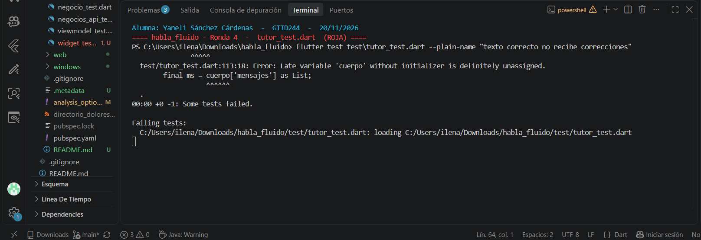

**Verde — la prueba pasa**

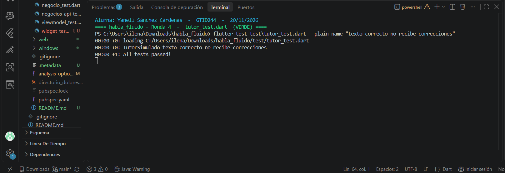

### Ronda 5

**Rojo — la prueba falla**

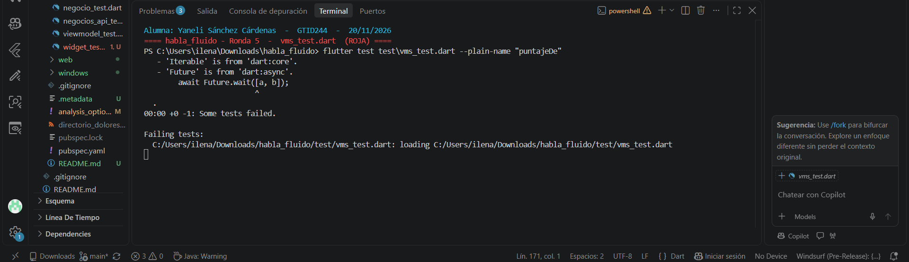

**Verde — la prueba pasa**

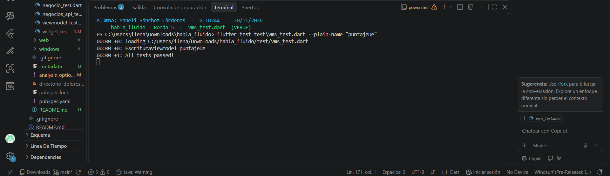

### Ronda 6

**Rojo — la prueba falla**

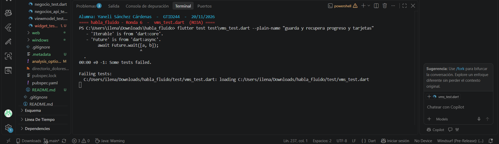

**Verde — la prueba pasa**

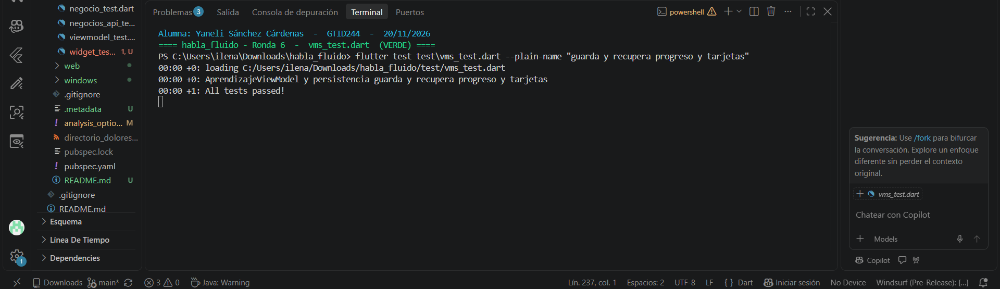

### Ronda 7

**Rojo — la prueba falla**

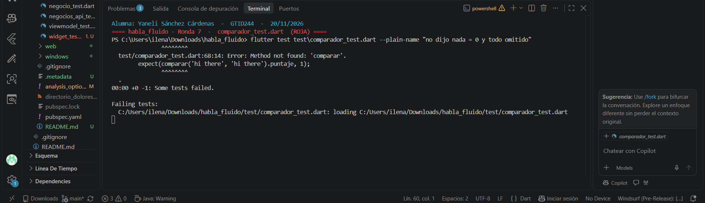

**Verde — la prueba pasa**

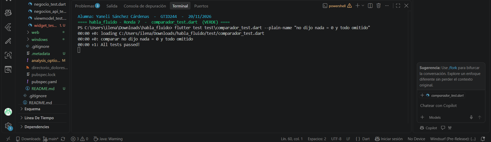

### Ronda 8

**Rojo — la prueba falla**

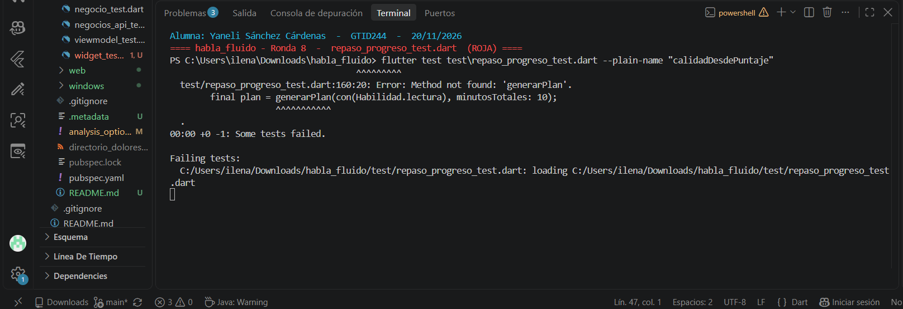

**Verde — la prueba pasa**

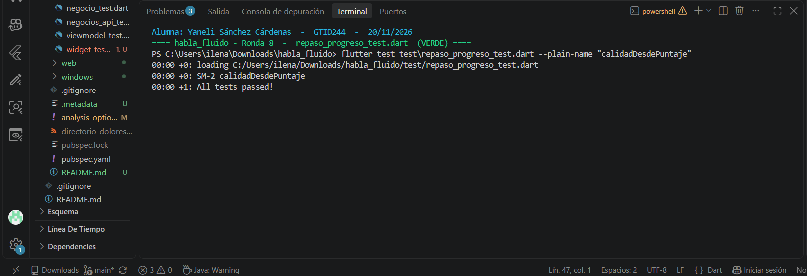

### Ronda 9

**Rojo — la prueba falla**

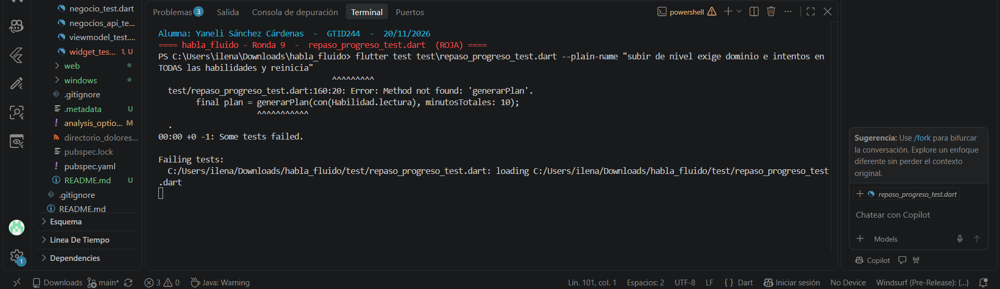

**Verde — la prueba pasa**

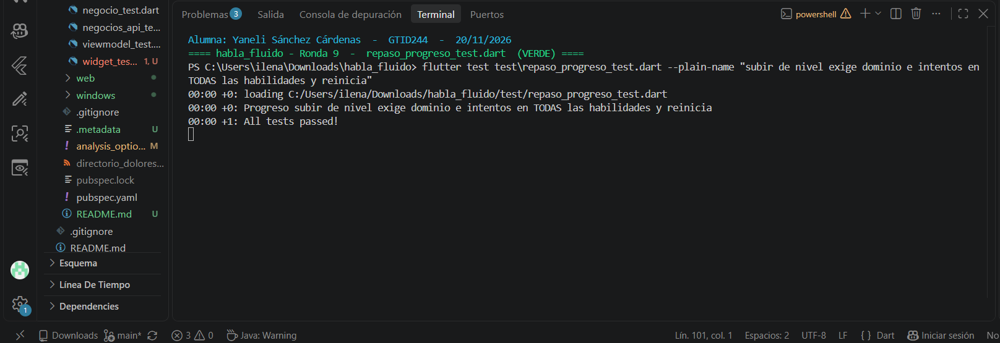
